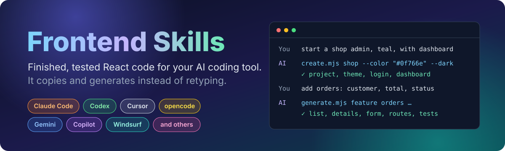
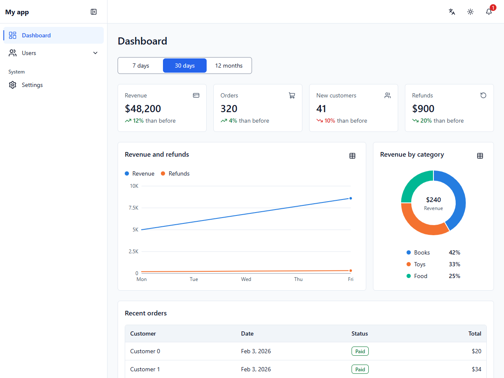
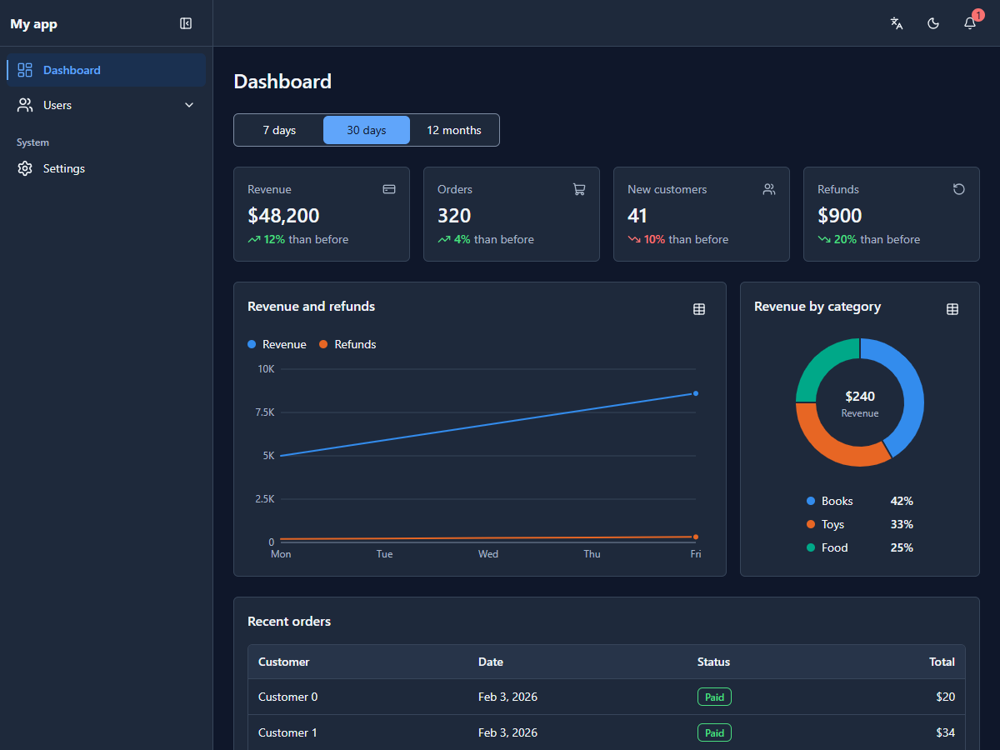
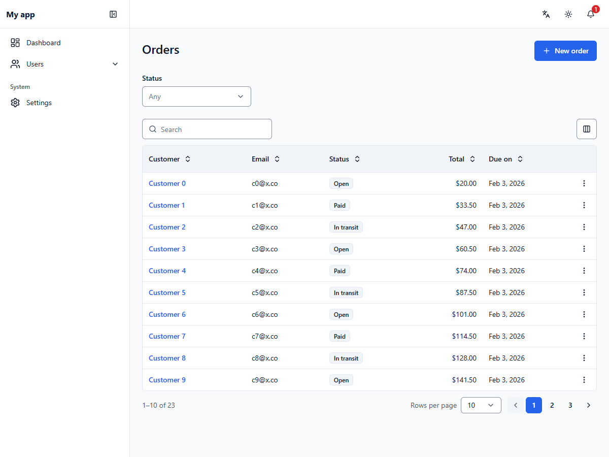
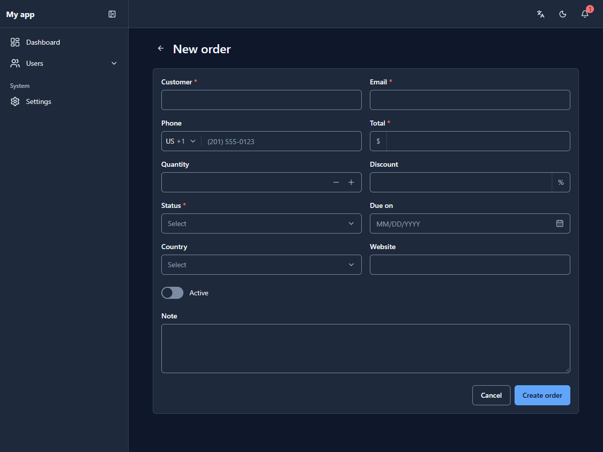
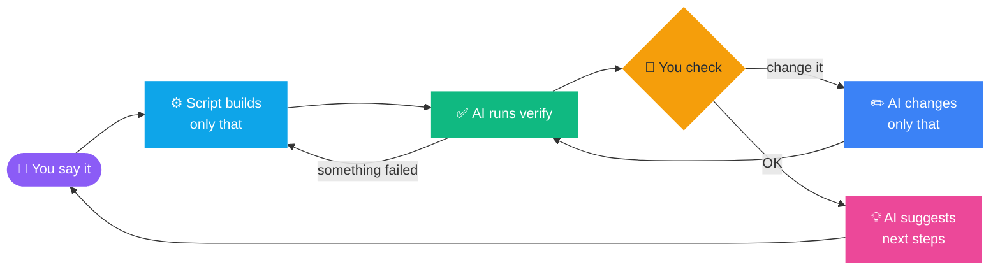
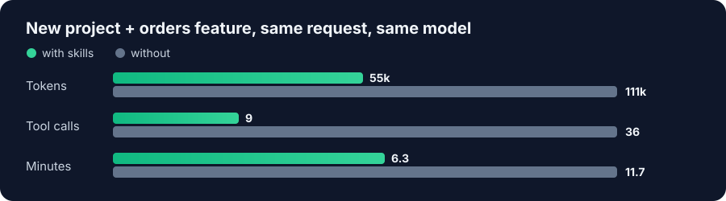
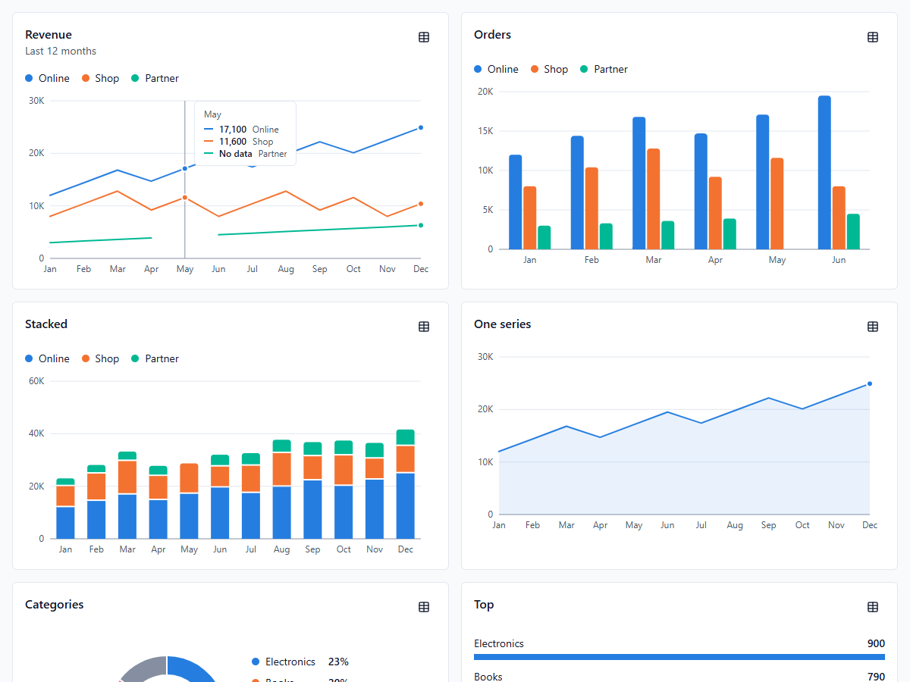

<div align="center">



<br>


[](LICENSE)

**[🚀 Quick start](#-quick-start)** ·
**[🧰 Your tool](#-set-up-your-tool)** ·
**[🆕 New project](#-new-project-you-ask-it-builds-only-that)** ·
**[💬 What to say](#-what-to-say)** ·
**[🪙 Tokens](#-tokens-how-it-stays-small)** ·
**[🩹 Help](#-something-does-not-work)**

</div>

---

## ✨ What is this?

Skills teach your AI coding tool to build React frontends **the same way every time**.
The finished code is already here. The AI runs a script that copies or generates it,
so it does not write, guess or explain the same things again.

<table>
<tr>
<td width="33%" valign="top">

### 🧱 Finished code
Forms, tables, dialogs, sidebar, login, dashboard, charts, kanban, dark mode and more.
Tested, accessible, works on phones.

</td>
<td width="33%" valign="top">

### 🎯 Only what you ask
It builds only what you ask: one component, one part, or a whole feature with tests. You
check it, then it suggests what could come next.

</td>
<td width="33%" valign="top">

### 🪙 Few tokens
About 400 tokens while you do not use them. Details load only when needed, and scripts
answer in a few lines.

</td>
</tr>
</table>

<table>
<tr>
<td width="50%"></td>
<td width="50%"></td>
</tr>
<tr>
<td width="50%"></td>
<td width="50%"></td>
</tr>
</table>

<div align="center"><sub>Dashboard block, and the list and form that <code>generate.mjs</code> writes</sub></div>

---

## 🚀 Quick start

You need [Git](https://git-scm.com) and [Node.js](https://nodejs.org) 20.19 or newer.

### The easy way: paste one line into your AI

Choose one and paste it into the chat of your tool:

> 🆕 **Start a new project**
>
> ```text
> Set up https://github.com/Pandi2352/frontend-skills.git - read AGENTS.md there and follow it. Then start a new React project.
> ```

> ➕ **Add it to the project I have open**
>
> ```text
> Set up https://github.com/Pandi2352/frontend-skills.git - read AGENTS.md there and follow it. Then add it to this project.
> ```

> 🔍 **Review the project I have open**
>
> ```text
> Set up https://github.com/Pandi2352/frontend-skills.git - read AGENTS.md there and follow it. Then review this project.
> ```

> 📦 **Only install, or update**
>
> ```text
> Set up https://github.com/Pandi2352/frontend-skills.git - read AGENTS.md there and follow it.
> ```

The AI downloads the skills, installs them and continues with your request. Your tool
may ask you to allow the commands.

### By hand: two commands

```bash
git clone --depth 1 https://github.com/Pandi2352/frontend-skills.git ~/frontend-skills
node ~/frontend-skills/install.mjs
```

It finds the tools on your computer and installs for all of them. **Then start a new
session in your tool.**

> **🤖 AI assistants:** if a user gave you this link, read
> [AGENTS.md](https://raw.githubusercontent.com/Pandi2352/frontend-skills/main/AGENTS.md)
> and follow it. Do not read the whole repository.

---

## 🧰 Set up your tool

| Tool | Install | Folder it reads | Start a skill yourself |
| --- | --- | --- | --- |
| 🟠 **Claude Code** | `node install.mjs --tool claude` | `~/.claude/skills` | `/frontend-core` |
| 🟢 **Codex** | `node install.mjs --tool codex` | `~/.agents/skills` | `$frontend-core` |
| ⚪ **Cursor** | `node install.mjs --tool cursor` | `~/.agents/skills` | `/frontend-core` |
| 🟡 **opencode** | `node install.mjs --tool opencode` | `~/.agents/skills` | name it in your message |
| 🔵 **Gemini CLI** | `node install.mjs --tool gemini` | `~/.agents/skills` | name it in your message |
| 🟣 **GitHub Copilot** | `node install.mjs --tool copilot` | `~/.agents/skills` | `/frontend-core` |
| 🔴 **Antigravity** | `node install.mjs --tool antigravity` | `~/.gemini/config/skills` | `/frontend-core` |
| 🟤 **Cline** | `node install.mjs --tool cline` | `~/.cline/skills` | `/frontend-core` |
| ⚫ **Kilo Code** | `node install.mjs --tool kilo` | `~/.agents/skills` | `/frontend-core` |
| 🩵 **Windsurf** | `node install.mjs --tool windsurf` | `~/.codeium/windsurf/skills` | name it in your message |
| 🟩 **Roo Code** | `node install.mjs --tool roo` | `~/.roo/skills` | name it in your message |

You rarely have to start one yourself. Say what you want, and the tool chooses.

<details>
<summary><b>🟠 Claude Code</b>: also as a plugin</summary>

<br>

```text
/plugin marketplace add Pandi2352/frontend-skills
/plugin install frontend-skills@frontend-skills
```

Use either the plugin or `install.mjs`, not both, or every skill is listed twice.
Type `/frontend` to see them.
</details>

<details>
<summary><b>🟢 Codex</b></summary>

<br>

Type `/skills` or `$` to see them. A new skill does not appear? Restart Codex. Codex
limits the list of all skills together; if you have many others, remove some.
</details>

<details>
<summary><b>⚪ Cursor</b></summary>

<br>

Type `/` in the Agent chat. Cursor also reads `~/.claude/skills`. If the skills appear
twice, keep one: `node install.mjs --tool claude --uninstall`.
Skills work in Agent mode, not in Ask mode.
</details>

<details>
<summary><b>🟡 opencode</b></summary>

<br>

Check with `opencode debug skill`. It reads `.agents` and `.claude` and shows each skill
once.
</details>

<details>
<summary><b>🔵 Gemini CLI, 🟣 Copilot and others</b></summary>

<br>

- **Gemini CLI** asks before it opens a skill; allow it.
- **Copilot** needs agent mode. If VS Code does not list them, put them into the project
  instead: `node install.mjs --project <your-project>`.
- **A tool without skills:** say *"Read `~/frontend-skills/skills/frontend-core/SKILL.md`
  and follow it."*
</details>

<details>
<summary><b>👥 Share with your team</b></summary>

<br>

Projects made with these skills contain `AGENTS.md`, `docs/` and `scripts/`, so teammates
and other tools follow the same rules without installing anything. To commit the skills
themselves too: `node install.mjs --project <your-project>`.
</details>

---

## 🆕 New project: you ask, it builds only that

The AI builds **exactly what you ask for, one thing at a time**. Then it tells you what to
check, suggests what could come next, and **waits**.

**1. Start with what you want now**

```text
Start a new React project "Shop admin" in ./shop. Teal #0f766e, with a sidebar.
```

You get the setup and the sidebar. Nothing else. You check it and say OK.

**2. Ask for the next thing, or take a suggestion**

```text
Built: Feature: orders
Please check:
  - /orders : list, search, sort, filter
  - create, edit, delete, required fields
Ideas for the next step:
  - "Show the orders as a board by status" (orders have a status)
  - "Show the orders in a calendar by dueOn" (orders have a date)
  - "Add login pages" (everybody can open the pages now)
OK? What next?
```

The ideas come from **your** project: its fields, what it has and what is missing.

| You say | The AI does |
| --- | --- |
| ✅ **"OK"** | marks it as checked and asks what comes next |
| 🧱 **"Add toasts"**, **"Add a date picker"** | copies only that, with what it needs |
| 📋 **"Add orders: customer, total, status"** | builds only that feature |
| ✏️ **"Make the sidebar darker"** | changes only that, then asks again |
| 📝 **"Later I also want login"** | remembers it, builds nothing |
| 🗑️ **"I do not want the dashboard any more"** | forgets it |
| 📍 **"Where are we?"** | shows what is done and ideas; also in a new chat |
| 🚀 **"Build everything at once"** | does not stop in between |

**3. What you can ask for**, in any order

| | Examples |
| --- | --- |
| 🖼️ Frame | sidebar or navbar, with a menu planned from your project |
| 🧱 Components | all common ones, or one: toast, modal, tabs, card, stepper |
| 📝 Forms | all fields, or one: date picker, phone, upload |
| 📊 Data | table, charts, kanban, calendar, CSV import |
| 🔐 People | login, profile, settings, notifications |
| 🌗 App | dark mode, languages, autosave, idle logout, speed |
| 📋 Features | your own data with list, details, form and tests |

`docs/PROGRESS.md` in your project shows what is done.

**The frame you get.** The AI plans the sidebar menu from what you describe (groups,
submenus, two-tone Phosphor icons) and shows it to you first. Then it builds the layout
against a full checklist, [`layout-spec.md`](skills/frontend-core/references/layout-spec.md):

- 🧭 collapse button at the navbar's left end, Ctrl/Cmd+B, remembered
- 📂 submenus that open smoothly and stay as you left them, fly-out when collapsed
- 📍 where you are in the navbar (Listings › Properties › All)
- 🔎 menu filter for long menus, badges, user menu with name and role
- 📱 drawer on phones; pages use the full width
- 🚧 404, 403 and error pages centered, with drawings in your colors
- 🛣️ routes with `react-router-dom` in `src/app/router/`

**4. No server yet?** Say so. The AI makes sample data that fits **your** project (real-looking
records, all statuses, matching ids) in `src/mocks/`, with a README, as
[`mock-data.md`](skills/frontend-api/references/mock-data.md) describes. The skills ship no
sample data of their own.

**5. Connect your server.** Set `VITE_API_URL` in `.env`, then delete `src/mocks/` and say:

```text
Connect the API. Here is the OpenAPI file: ./openapi.json
```

<details>
<summary><b>🧑‍💻 Do it yourself, without an AI</b></summary>

<br>

```bash
S=~/frontend-skills/skills/frontend-core/scripts
node $S/create.mjs shop --title "Shop admin" --color "#0f766e" --ask sidebar,login
node $S/steps.mjs shop                 # what was asked, what is done, ideas
node $S/steps.mjs shop ok              # I checked it
node $S/steps.mjs shop next            # the next thing I asked for
node $S/steps.mjs shop build toast     # something new
node $S/steps.mjs shop build feature:orders --fields "customer:text!, status:select(open|paid)"
node $S/steps.mjs shop list            # everything that can be built
```

Each step installs only the packages it needs, newest for your Node version (which is never
changed). Files you changed are not overwritten.
</details>



<details>
<summary><b>⚙️ All options of <code>create.mjs</code></b></summary>

<br>

| Option | Meaning |
| --- | --- |
| `--title "My app"` | name in the sidebar and browser tab |
| `--color "#2563eb"` | main color; made darker if text would be hard to read |
| `--layout navbar` | without sidebar |
| `--locale en-IN --currency INR --country IN` | formats and defaults |
| `--ask a,b` | what you want, in order; built one by one |
| `--all` | builds everything in `--ask` at once |
| `--no-install` | only files |
</details>

### ➕ Existing project

```bash
cd ~/frontend-skills/skills
node frontend-core/scripts/add-to-project.mjs <your-project> --components   # components and rules
node frontend-api/scripts/add-to-project.mjs <your-project>                 # API and login code
node frontend-performance/scripts/add-to-project.mjs <your-project>         # speed code and checks
node frontend-blocks/scripts/add.mjs <your-project> charts dark-mode        # single blocks
```

Your files are never overwritten. Leave out `--components` if you have your own. Or say:
*"Use frontend-core in this project."*

---

## 💬 What to say

| You want | Say |
| --- | --- |
| 📋 A feature | "Add a customers feature with name, email, phone, country and status" |
| 📝 A form | "Create a settings form with logo upload, time zone and tax rate" |
| 📊 Numbers | "Add a dashboard with revenue, orders and a chart" |
| 🗂️ A board | "Show the tasks as a kanban board" |
| 📥 Import | "Let people import customers from a CSV file" |
| 🔐 Login | "Add login, register and forgot password" |
| 🌗 Theme | "Add dark mode" |
| 🌍 Languages | "Add Tamil and Arabic" |
| 🔌 Server | "Connect the API and show server errors below the fields" |
| 🐢 Speed | "The orders page is slow, make it faster" |
| 🔍 Check | "Review this page and list what to fix" |

**Good requests are short and complete:** which data, which fields are required, which
endpoints. One feature per message.

---

## 🪙 Tokens: how it stays small

<div align="center">

</div>

<sub>One run each with Claude Sonnet, everything in one request: a new project with theme, login, dashboard and an
orders feature. The numbers include the tool's own start-up text, so the part you can
influence shrank even more. The result with skills came with 329 tests, the other with
20. Your numbers will differ.</sub>

| When | What the AI reads | Tokens, about |
| --- | --- | --- |
| Always, unused | name and description of 5 skills | **400** |
| In a project made with it | `AGENTS.md` | **480** |
| You ask for frontend work | one skill file | **500 to 1,200** |
| To see what exists | `docs/COMPONENTS.md` | **1,100** |
| Props of one component | `index-components.mjs DataTable` | **100 to 300** |
| Special case | one reference file | **500 to 2,600** |
| Never | the finished code (it is copied, not read) | 0 instead of **174,000** |

**Why it works**

- 🧩 **On demand.** A tool loads only names at first, then one file, then one detail.
- ⚙️ **Scripts instead of writing.** Copying 180 files costs one command.
- 🔎 **Asking instead of opening.** Props come from a script, not from big files.
- 🤫 **Short answers.** `verify` prints one line per check and only the first errors.

**Your part**

1. A few things per chat. The state is saved, so a new session can continue.
2. Say the fields and endpoints in the first message.
3. Do not say "read all skills" or "read the whole project".
4. Let it run `verify` once at the end, `--fast` in between.
5. Remove skills you never use: `node install.mjs frontend-core frontend-blocks`.

---

## 📦 What is inside

| Skill | For |
| --- | --- |
| 🧱 **[frontend-core](skills/frontend-core/SKILL.md)** | new projects, generators, 45+ fields, forms, tables, dialogs, sidebar, navbar |
| 🧩 **[frontend-blocks](skills/frontend-blocks/SKILL.md)** | ready parts, copied only when you need them |
| 🔌 **[frontend-api](skills/frontend-api/SKILL.md)** | API client, login, token refresh, permissions, upload |
| ⚡ **[frontend-performance](skills/frontend-performance/SKILL.md)** | size limits, lazy loading, long lists, images, leak and Lighthouse checks |
| 🔍 **[frontend-review](skills/frontend-review/SKILL.md)** | finds rule breaks, slow code and AI mistakes |

<details>
<summary><b>🧱 Components</b></summary>

<br>

- **Text:** input, password, search, textarea, mask, OTP, tags, inline edit
- **Numbers:** number, currency, percent, slider, range, rating
- **Choice:** checkbox, radio, switch, dropdown, combobox, multi-select, tree, transfer list
- **Date:** date, range, time, date-time, month, year
- **Place:** phone, country, state, city, address, time zone, currency, language
- **Files:** file, image, avatar, signature, color
- **Feedback:** toast, modal, drawer, confirm, alert, tooltip, loaders, skeletons, progress
- **Data:** table, pagination, filters, cards, stats, key-value list, timeline, badge, avatar
- **Navigation:** sidebar, navbar, tabs, accordion, stepper, breadcrumb, command menu
- **States:** empty, no results, error, offline, error boundary, 403, 404
</details>

<details>
<summary><b>🧩 Blocks</b></summary>

<br>

| Block | What |
| --- | --- |
| `charts` | line, area, column, stacked, donut, ranking, sparkline |
| `dashboard` | numbers, charts, recent rows, period filter |
| `kanban`, `drag-sort` | board and sortable list, also by touch and keyboard |
| `calendar` | month and agenda |
| `csv-import` | file, match columns, check, import |
| `infinite-list` | endless list |
| `auth-pages` | login, register, code, forgot, reset, change password |
| `account-pages` | profile, settings |
| `dark-mode`, `i18n` | themes; languages with right-to-left |
| `unsaved-changes`, `autosave` | nothing gets lost |
| `notifications`, `realtime` | bell and page; WebSocket |
| `idle-logout` | sign out after inactivity |


</details>

<details>
<summary><b>⌨️ Commands in a project</b></summary>

<br>

```bash
node scripts/generate.mjs feature orders --fields "customer:text!, total:currency!, status:select(open|paid), dueOn:date"
node scripts/generate.mjs component shared/StatusDot
node scripts/generate.mjs page reports/SalesReport
node scripts/index-components.mjs                  # list what exists
node scripts/index-components.mjs DataTable        # props of one
node scripts/verify.mjs --fast                     # changed files only
node scripts/verify.mjs                            # everything
node scripts/resolve-versions.mjs --project zod    # newest version for your Node
npm run measure                                    # Lighthouse; needs the lighthouse package
```

Field types: `text textarea email url phone number currency percent date switch country
select(a|b)`. `!` means required.
</details>

<details>
<summary><b>📏 Rules every project follows</b></summary>

<br>

- Reuse before writing. One version of every component.
- All fields have the same height and look. Label above, error directly below.
- No native `<select>`, date, time or color inputs, no browser dialogs.
- Design tokens only, `rounded-md`, no shadows, Lucide icons.
- Loading, empty and error state in every view. Keyboard, WCAG AA, 360 px.
- Newest packages that work with your Node. Your Node version is never changed.
</details>

<details>
<summary><b>🎨 Make it yours</b></summary>

<br>

| Change | File in your project |
| --- | --- |
| Colors, sizes, spacing | `src/styles/theme.css`, `dark.css` |
| Name, formats, currency, country | `src/config/app.config.ts` |
| Words inside components | `src/constants/ui-text.ts`, `field-text.ts` |
| Menu and paths | `src/config/navigation.ts`, `routes.ts` |
| Roles and permissions | `src/config/permissions.ts` |
| Server addresses | `src/features/*/services/*.service.ts` |
| Rules for the AI | `AGENTS.md` |

Guides: [fields and forms](skills/frontend-core/references/fields-and-forms.md) ·
[components](skills/frontend-core/references/components.md) ·
[app shell](skills/frontend-core/references/app-shell.md) ·
[layout checklist](skills/frontend-core/references/layout-spec.md) ·
[sample data](skills/frontend-api/references/mock-data.md) ·
[data blocks](skills/frontend-blocks/references/data.md) ·
[pages and features](skills/frontend-blocks/references/features.md) ·
[auth](skills/frontend-api/references/auth.md) ·
[loading](skills/frontend-performance/references/loading.md) ·
[rendering](skills/frontend-performance/references/rendering.md) ·
[AI mistakes](skills/frontend-core/references/ai-mistakes.md)
</details>

---

## 🩹 Something does not work?

<details>
<summary><b>The AI does not use the skills</b></summary>

<br>

1. Start a **new session**; skills are read at the start.
2. `node ~/frontend-skills/install.mjs --list` shows the folders. Is your tool there?
3. Name it: *"Use the frontend-core skill."*
4. In a project, `AGENTS.md` tells every tool to use the scripts. Missing?
   Run `add-to-project.mjs`.
</details>

<details>
<summary><b>It uses too many tokens</b></summary>

<br>

Is it opening files in `assets/` or long component files? Say: *"Use the scripts, do not
open assets."* Start a new session for each feature. Remove other skills you do not need;
every installed skill costs a little in every session.
</details>

<details>
<summary><b>The skills appear twice</b></summary>

<br>

Your tool reads two folders, or you installed the Claude plugin as well. Keep one:
`node install.mjs --tool claude --uninstall`, or remove the plugin.
</details>

<details>
<summary><b>A check fails</b></summary>

<br>

Paste the output of `npm run verify` and say *"fix this"*. `node scripts/verify.mjs --all`
shows everything.
</details>

<details>
<summary><b>Install fails, or a package is not the newest</b></summary>

<br>

`node -v` must be 20.19 or newer. Packages are chosen for your Node, so some are older on
purpose; the output says which and why. On Windows, close tools that use the folder.
</details>

<details>
<summary><b>My server has other names or paths</b></summary>

<br>

Change only `services/*.service.ts`. Pages and forms stay as they are.
</details>

<details>
<summary><b>Next.js or another framework</b></summary>

<br>

Create the project with its own command, then use `add-to-project.mjs --components`. The
router parts need changes; see
[new-project.md](skills/frontend-core/references/new-project.md).
</details>

### 🔄 Update and uninstall

```bash
cd ~/frontend-skills && git pull && node install.mjs    # update
node ~/frontend-skills/install.mjs --uninstall          # remove
```

Projects keep their own copy of the code.

### 🚧 Good to know

- The server addresses in generated code are assumptions. Check each `*.service.ts`.
- The Arabic texts are an example; let a native speaker check them.
- Not included: calendar with hours, map charts, Excel files, rich text and code editor.
- Tested in Chrome on Windows with Node 20. Found by Claude Code and opencode; the other
  tools are set up as their documentation says, but not tried.

### 🛠️ Change a skill

Edit the files in `skills/`, run `node install.mjs`, commit and push.

### 📄 License

[MIT](LICENSE). Use it in private and commercial projects, and change it as you like.

<div align="center">
<br>
<sub>Made for people who want the AI to build, not to repeat itself. ⭐ if it helps.</sub>
</div>
